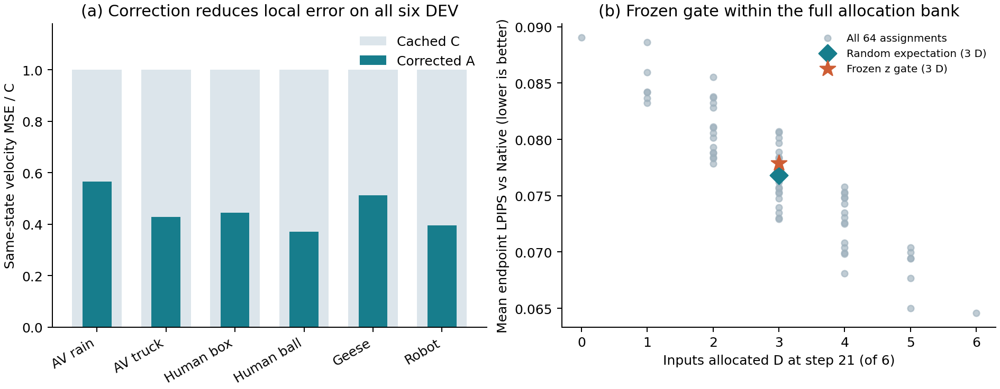

<!-- Generated by docs/tools/render_repository_docs.py; edit canonical JSON or docs/templates/, then render. -->

# CARA-Cache

[768 CPU资源修订与完整RGB容量](research/768_CARA_BUDGET_CPU_RESOURCE_REPAIR_AND_RGB_STORAGE_20261030.md)：R2资源绑定修复完成：四卡原CPU退出/0，1CPU/4GiB/零swap配置与来源核验通过，31项组件控制、54成功tiny路径、8预定失败及12完整双FIT目标完成；8项本地资源/接收器控制通过。两卡资源门拒绝且原stage不存在，可用51.26GiB低于保留S内存的56GiB门，双端接受仍待。RGB容量组件3项控制通过，默认604份完整NPY约208.28GiB；实际查询预算、专用存储及整卡报价尚未冻结。本轮0GPUh。

**2026-10-28最新安排：主线P0/F19，探索S-FAST19与固定Shared25-C的Q并行准备。** [最新计划与两个对话分工](plans/cara_next_stage_20261028/08_REPOSITORY_RECONCILIATION.md) · [739接收记录](research/739_CARA_NEXT_STAGE_FAST_SQ_PLAN_AND_CHAT_HANDOFF_20261028.md)。A32已完整验收并冻结；B36已获单次批准，实际状态以原运行记录为准。WC73已热停结算，禁止自动重派；原DEV128、旧合同与失败保持。以下旧准备记录仅作历史复用依据。

[741主线R2与A32审阅](research/741_CARA_FAST_CLEAN_BINDING_DUAL_CPU_AND_A32_REVIEW_20261028.md)：新采样路由、实际93帧合成评分CLI和Linux生命周期控制双端接受；完整三臂控制及独立clean Native使提案改为68条（A32+B36）。下一最小A32预计4.7–5小时、硬限5GPUh，仍需新卡授权和fresh资源准入；cap226保持，原Ada142根因未证明；[采样/评分CPU接受](reports/cara_fast_scoped_CPU_acceptance_r2_20261028.json) · [编排CPU控制接受](reports/cara_fast_orchestration_CPU_acceptance_r3_20261028.json)。该段为启动前CPU准备快照；当前A32运行见下，旧时钟与原科学结果不改。

[745 A32完整评分与冻结基线](research/745_CARA_A32_COMPLETE_FIT_SCORES_AND_FROZEN_BASELINES_20261029.md)：A32完整32/32、技术/释放/原费用及12对93帧评分均已接受，实际2.2557055054700728GPUh已中央结算。按原规则冻结WC_T006、RA_T1与Native22；WC/RA保留UNMATCHED，只有Native22满足1.5目标的5%时间窗。仅两个旧CAL的FIT校准，无F19比较或新输入结论；两项检查已删除，B36未启动。 [唯一启动回执](reports/cara_fast_A6000_GPU_actual_launch_r1_20261028.json)。该段保留A32完成时快照，当前B36见原运行记录。

[743 B36双端CPU承接接受](research/743_CARA_B36_COMPLETE_CONTINUATION_DUAL_CPU_ACCEPTANCE_20261029.md)：每端两种flow各完整36条，合计72条成功tiny路径，失败清理与禁止重试通过；CPU使用合成冻结包，实际基线采用A32完整验收后的原一次冻结文件。[CPU接受回执](reports/cara_fast_B36_CPU_acceptance_r1_20261029.json)

[749 B36图表承接CPU接受与待审批](research/749_CARA_B36_FIGURES_DUAL_CPU_AND_LAYOUT_20261029.md)：启动前执行22项、汇总6项、绘图6项分别双端接受，四组图及四CSV已作显式CPU夹具和图面验证；原52执行/4汇总源码及原冻结保持。此处保留CPU准备快照，当前单次B36以实际启动记录为准，不授予重派。 [组合CPU接受](reports/cara_fast_B36_dispatch_CPU_acceptance_r2_20261029.json) · [剩余派发边界](plans/cara_next_stage_20261028/mainline/r2/B36_GPU_REVIEW_R2.md)

[756 B36完整验收、结果与正式图表](research/756_CARA_B36_COMPLETE_ACCEPTANCE_RESULTS_AND_FIGURES_20261029.md)：B36完整36/36、0失败，原GPU/CPU/导图CPU均正常退出；原费用2.384553982338661GPUh已中央唯一结算，5.5GPUh硬限、cap226及旧16.5保持。26新评分＋六原A指标组成完整32接受；原规则汇总及四组PNG/PDF、四CSV均完成，两个自动检查已删除。4旧CAL输入等权结果：F19_C为1.703×T_DD、1.486×完整请求，Alex0.24936，较同19D的Uniform19_C降低46.82%；F19_A1为1.691×/1.479×、Alex0.23150，较F19_C再降7.16%，T_DD开销0.70%。WC/RA保持FIT UNMATCHED，原A32评分与冻结未重做；CHECK仍为旧CAL内部留出。10月30日原Tailscale入口恢复后已只读复核中央原结算；原费用和完整接受保持，新GPU仍需fresh准入。 [B36唯一启动回执](reports/cara_fast_B36_GPU_actual_launch_r1_20261029.json) · [原句柄与验收交接](plans/cara_next_stage_20261028/mainline/r2/B36_POST_LAUNCH_HANDOFF.md)

**通过选择完整刷新的时间位置，在加速视频扩散时尽量保留完整模型的输出。**

CARA-Cache（CFG-Aligned Readout and Cost-Aware Allocation for Video Diffusion）是一个基于 Cosmos / WorldCache 实验栈的视频扩散加速研究项目。它研究两个相连的问题：缓存读出怎样更准确，以及有限计算预算应该花在哪些时间步。当前冻结的新DEV候选Shared25-C采用完整刷新D与缓存复用C，不包含修正A；A保留为机制对照。CARA为沿用的项目名。历史目录 `worldcache_omr` 与 Python 包 `wcomr` 为兼容既有实验保留；本仓库当前只维护 WorldCache/CARA 主线。

## 第一次阅读

| 想了解什么 | 从这里进入 |
|---|---|
| 做了什么、主要结果怎样 | [研究与结果概览](EXPERIMENT_REPORT.md) |
| 现在在跑什么、下一次何时验收 | [当前状态](research/02_CURRENT_STATE.md) |
| 每项实验是否完成、支持什么结论 | [60项实验总表](paper/EXPERIMENT_MASTER_TABLE.md) |
| 下一步解决什么问题 | [后续实验顺序](research/09_NEXT_ACTIONS.md) |
| 如何复核代码、原件和统计 | [复现与证据指南](docs/REPRODUCIBILITY.md) |
| 从项目开始到现在的完整记录 | [历史入口](docs/archive/README.md) |

## 方法直觉

扩散模型逐步生成视频。完整计算昂贵，复用旧缓存会积累误差；当前研究重点是在固定刷新次数下，保留过渡区间的完整计算、减少末段刷新。CAL66的Shared25-C采用这一布局，DEV128已完成冻结继续验证，当前将它保留为高保真参照，并准备高速F19与S/Q机制。历史修正A利用当前浅层增量和真实深层锚点，在新DEV中作为机制对照。

使用原R2论文数值索引；32条单人诊断另见760记录，原冻结/指标/FIT标签保持。F18与Q5 Native50组件已双端CPU接受，方法、整卡范围和报价仍待，GPU顺序S优先。

CFG 指 classifier-free guidance，包含条件与负条件两支。A 使用共享修正强度，保持两支融合口径一致。D 更新当前请求的真实深层锚点；A 不把近似结果冒充新的真实锚点。Native 是每个请求步均完整计算的参考推理。

当前流程是：**公平基线与评价/时钟 → F19可行性及S/Q独立准备 → 冻结规则 → 第二预算/网格 → 第二骨干与独立确认**。当前网格上能量规则与简单模板给出相同掩码；自动规则的额外价值留给可区分两者的新设置检验。历史GRAPH搜索与C/A/D生成器单独保留。

阅读数字时：**CAL**是校准集，**DEV**是开发验证集，**TEST**是方法冻结后才使用的独立测试集；`26D`表示26次完整刷新，`A1/A3`表示所考察窗口内修正1次/连续3次。

## 已经得到什么结果

- **F19布局在4旧CAL的同19D比较中降低参考误差**（旧CAL4，B36完整36与32评分，双时钟）：F19_C为1.703倍T_DD、1.486倍完整请求速度，Alex0.24936，较Uniform19_C降低46.82%；F19_A1为1.691倍T_DD、Alex0.23150，较F19_C再降低7.16%，4/4同向。 [证据1](research/756_CARA_B36_COMPLETE_ACCEPTANCE_RESULTS_AND_FIGURES_20261029.md) · [证据2](reports/cara_fast_B36_complete_analysis_r1_20261029.json) · [证据3](reports/cara_fast_B36_figures_actual_r1_20261029/report.json)
- **Shared25-C通过16新DEV冻结验证**（DEV16，完整128，冻结强基线与双预算）：相对冻结S25-A的LPIPS降低14.82%，16/16改善；相对S25-C降低26.16%。246.675秒、约1.269倍，V单侧95%上界0.9863；三项质量非劣门均通过。 [证据1](research/716_CARA_DEV128_COMPLETE_ACCEPTANCE_AND_FROZEN_DECISION_20261027.md) · [证据2](reports/cara_DEV128_A6000_complete_analysis_20261027.json)
- **Shared25-C通过完整CAL筛查**（CAL4，同批强基线，冻结待DEV）：同批A6000四个CAL上，Shared25-C相对较强S25-A的LPIPS下降15.34%，4/4改善；246.852秒，原双预算和三项独立质量筛查通过。 [证据1](research/702_CARA_CAL66_A6000_COMPLETE_RESULTS_AND_FROZEN_SHARED25_C_20261026.md) · [证据2](reports/cara_CAL66_A6000_complete_analysis_20261026.json)
- **修正读出有跨输入机制收益**（6个新DEV，局部机制）：BANK24六个新DEV中，A相对C的同状态扩散速度预测MSE全部降低43.53%–63.00%，等权场景均值降低52.53%。 [证据1](research/644_CARA_BANK24_COMPLETE_DEV6_RESULTS_20261022.md)
- **连续修正改善最终视频保真**（4个旧CAL，同25D布局）：Window24同25D布局下，A3较C的平均LPIPS低26.6335%，较A1低19.7690%；CAL12四格补齐了后两次A的独立增量。 [证据1](research/604_WC_WINDOW24_FULL24_ACCEPTED_CONTINUOUS_CORRECTION_RESULTS_AND_CAL12_NEXT_20261019.md) · [证据2](research/609_WC_CAL12_FULL_FACTORIAL_A_AND_SHARED_PLAN_INDEPENDENT_EFFECTS_20261019.md)
- **固定预算下刷新位置影响保真**（4个旧CAL，同26D/10C）：CAL12同26D、同纯C的共享计划较前密C的LPIPS低15.36%，四场景均改善。 [证据1](research/609_WC_CAL12_FULL_FACTORIAL_A_AND_SHARED_PLAN_INDEPENDENT_EFFECTS_20261019.md)
- **已有质量—时间工作点**（4个旧CAL，历史冻结工作点）：D14同批比较中，Efficient比WorldCache耗时少13.72%、LPIPS低11.1600%；同26D的A较plain低3.5196%，增加0.8762秒。 [证据1](research/420_WC_FULL60_COST_CURVE_COMPLETE_RESULTS_AND_CONVERGENCE_20261014.md) · [证据2](research/552_WC_N08_FULL40_ACCEPTED_REPEATED_TIMING_AND_PENDING_TASK_CLOSURE_20261017.md) · [证据3](research/599_WC_N10_FULL960_ACCEPTED_DIMENSIONWISE_RESULTS_AND_WINDOW24_RESOURCE_QUEUE_20261018.md)
- **冻结单点门控未优于随机配额分配**（6个新DEV，同3D配额）：BANK24冻结z门控在同3D配额的20种分配中排12/20；LPIPS 0.0778937，高于随机分配期望0.0768148。 [证据1](research/644_CARA_BANK24_COMPLETE_DEV6_RESULTS_20261022.md)

LPIPS 越低表示越接近同输入的 Native 视频；它与局部速度 MSE、语义/物理质量、实际延迟分别报告。更多共同评价、重复时间、自动质量及失败分母见[结果概览](EXPERIMENT_REPORT.md)。



图左展示修正的局部误差收益，图右展示刷新分配的完整比较；两者共同说明后续自动策略需要解决的问题。[完整分析](research/644_CARA_BANK24_COMPLETE_DEV6_RESULTS_20261022.md)。

## 当前进度

**B36完整链已验收并完成图表，全部原实验已退出。**

B36完整36/36、0失败，原GPU/CPU/导图CPU均正常退出；原费用2.384553982338661GPUh已中央唯一结算，5.5GPUh硬限、cap226及旧16.5保持。26新评分＋六原A指标组成完整32接受；原规则汇总及四组PNG/PDF、四CSV均完成，两个自动检查已删除。4旧CAL输入等权结果：F19_C为1.703×T_DD、1.486×完整请求，Alex0.24936，较同19D的Uniform19_C降低46.82%；F19_A1为1.691×/1.479×、Alex0.23150，较F19_C再降7.16%，T_DD开销0.70%。WC/RA保持FIT UNMATCHED，原A32评分与冻结未重做；CHECK仍为旧CAL内部留出。10月30日原Tailscale入口恢复后已只读复核中央原结算；原费用和完整接受保持，新GPU仍需fresh准入。

[证据1](plans/cara_next_stage_20261028/mainline/r2/B36_USER_AUTHORIZATION_20261029.json) · [证据2](reports/cara_fast_B36_GPU_actual_launch_r1_20261029.json) · [证据3](reports/cara_fast_B36_original_context_startup_r1_20261029.json) · [证据4](reports/cara_fast_B36_runtime_observation_r1_20261029.json) · [证据5](reports/cara_fast_B36_actual_admission_r1_20261029.json) · [证据6](reports/cara_fast_B36_actual_storage_r1_20261029.json) · [证据7](reports/cara_fast_B36_actual_central_reservation_r1_20261029.json) · [证据8](reports/cara_fast_B36_live_budget_after_launch_r1_20261029.json) · [证据9](reports/cara_fast_B36_acceptance_schedule_r1_20261029.json) · [证据10](reports/cara_fast_B36_check_followup_policy_r1_20261029.json) · [证据11](reports/cara_fast_B36_precommit_status_r1_20261029.json) · [证据12](reports/cara_fast_B36_recovered_status_r1_20261029.json) · [证据13](reports/cara_fast_B36_original_terminal_r1_20261029.json) · [证据14](reports/cara_fast_B36_original_central_settlement_r1_20261029.json) · [证据15](reports/cara_fast_B36_original_release_accepted_r1_20261029.json) · [证据16](reports/cara_fast_B36_original_score_manifest_r1_20261029.json) · [证据17](reports/cara_fast_B36_original_score_CPU_launch_r1_20261029.json) · [证据18](reports/cara_fast_B36_original_CPU_operational_r1_20261029.json) · [证据19](reports/cara_fast_B36_original_connection_recovered_r1_20261029.json) · [证据20](reports/cara_fast_B36_original_CPU_score_capture_r3_20261029.json) · [证据21](reports/cara_fast_B36_complete_scores_accepted_r1_20261029.json) · [证据22](reports/cara_fast_B36_complete_analysis_r1_20261029.json) · [证据23](reports/cara_fast_B36_figures_actual_r1_20261029/report.json) · [证据24](reports/cara_fast_B36_figures_actual_CPU_acceptance_r1_20261029.json) · [证据25](reports/cara_fast_B36_figures_actual_visual_QA_r1_20261029.json) · [证据26](reports/cara_fast_B36_complete_acceptance_cleanup_r1_20261029.json) · [证据27](reports/cara_fast_B36_postacceptance_connection_observation_r1_20261029.json) · [证据28](reports/cara_fast_B36_complete_final_revalidation_r1_20261029.json)

历史研究阶段：[原P1](research/669_CARA_PG_P1_COMPLETE_BUDGET_ATTRIBUTION_AND_REPAIR_PLAN_20261024.md)未选出预算可行策略；[104](research/685_CARA_HISTORY104_R2_COMPLETE_ACCEPTANCE_RESULTS_AND_COST_GATE_20261024.md)与[COST112](research/690_CARA_COST112_COMPLETE_ACCEPTANCE_AND_TIMING_GATE_FAILURE_20261025.md)完成采集，但原最大低估计时门均失败。该路线暂缓，失败与费用保持；当前按[CAL66完整结果](research/702_CARA_CAL66_A6000_COMPLETE_RESULTS_AND_FROZEN_SHARED25_C_20261026.md)保留Shared25-C已完成的DEV128结论；未来工作按顶部新计划推进。

## 仓库结构与使用

| 目录 | 内容 |
|---|---|
| `src/wcomr/` | 缓存读出、来源管理、调度与实验实现 |
| `scripts/`、`tests/` | 运行、采集、验收、分析及相应控制 |
| `configs/`、`manifests/`、`plans/` | 冻结配置、资产/源码身份、实验登记 |
| `research/`、`reports/` | 解释性研究记录与机器回执；历史原件持续保留 |
| `paper/` | 实验总表、术语映射、图表及论文材料 |
| `docs/` | 新读者指南、统一状态数据、文档生成器及归档 |

仅检查阅读层（Python标准库，无模型、无服务器连接、无GPU提交）：

```bash
python3 docs/tools/render_repository_docs.py --check
```

运行实验需对应卡的固定资源、生产CPU验证、完整成本与准入条件，见[复现指南](docs/REPRODUCIBILITY.md)。日常文档更新只改规范数据和模板，再统一生成，见[维护规则](docs/MAINTENANCE.md)。

历史存储维护和失败恢复记录：[677空间归因](research/677_CARA_DISK_GROWTH_ATTRIBUTION_SAFE_MIGRATION_AND_104_RECOVERY_20261024.md)、[679恢复方案](research/679_CARA_HISTORY104_FAILED_SETTLEMENT_STORAGE_GUARD_AND_FINAL_RECOVERY_20261024.md)、[680执行](research/680_CARA_HISTORY104_R2_EXCLUSIVE_LAUNCH_AND_ACCEPTANCE_20261024.md)。它们描述当时状态；当前运行与准备以本页快照为准。
