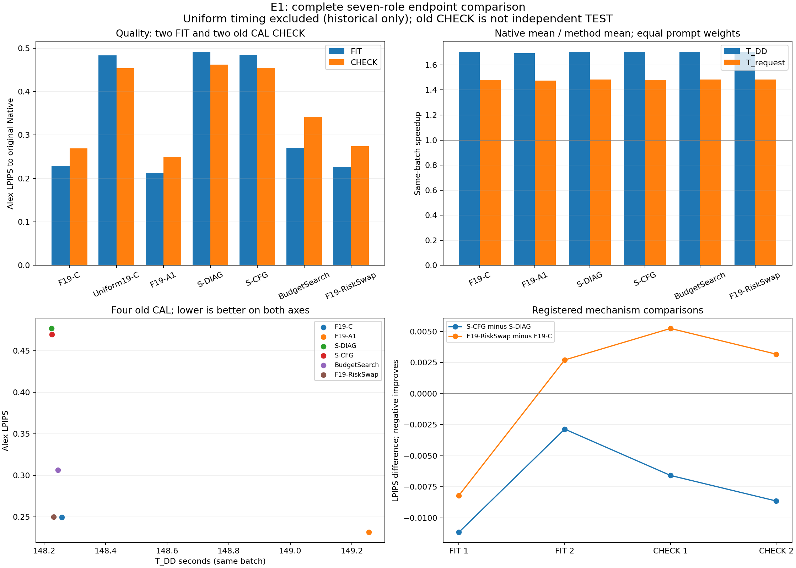
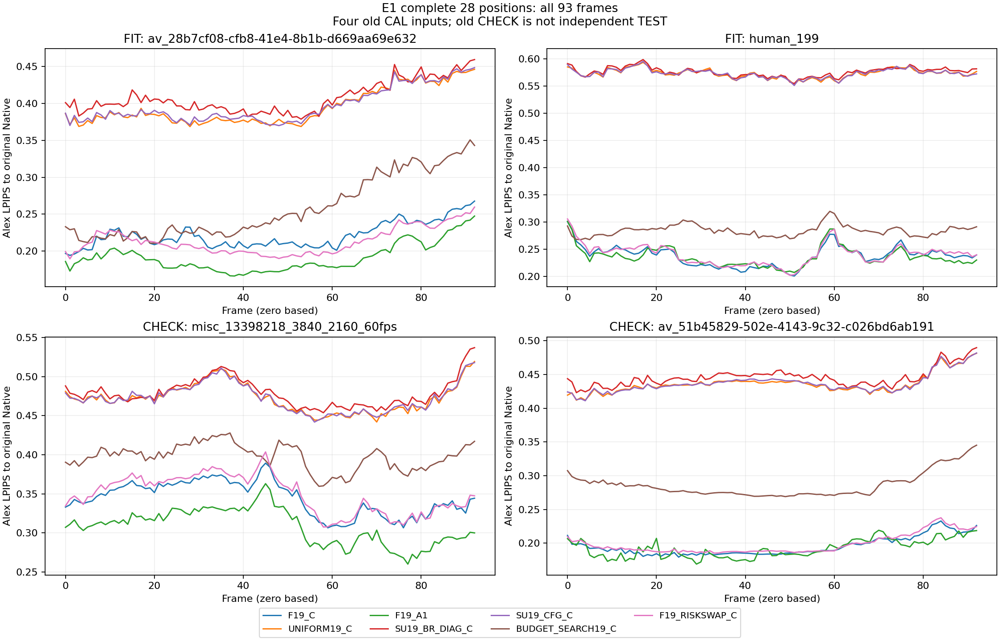

# 826 — E1完整验收、七角色结果与预注册判断

2026-11-01，北京时间。用户要求修复接口并继续验收后，独立兼容层通过真实发布回执的8项回归、原实际模型SHA和全46工件读回；全部13/13RGB身份门通过。原固定CPU评分器一次完成16新对，与12原B36指标行组成28完整位置；原12行逐行保持、所有93帧/92相邻帧对均验证。原评分容器正常退出，监督/CLI/worker句柄均结束，评分墙钟504.610173秒，低于硬2小时。原GPU、失败读者、原1268源和3.0556730066974542GPUh唯一结算全部保留，没有重跑GPU或二次记账。

## 完整结果

按注册规则先在每个输入内平均正式/重放和重复，再对输入等权；加速为Native均值/方法均值。六角色使用本批38个干净计时，Uniform只展示原批质量，不混合历史时间。所有质量相对原Native，越低LPIPS越好。

| 角色 | 全四输入LPIPS↓ | FIT | 旧CHECK | 同批T_DD秒 | 同批完整请求秒 | 双时钟加速 |
|---|---:|---:|---:|---:|---:|---|
| F19-C | 0.249365 | 0.229234 | 0.269495 | 148.258 | 219.378 | 1.704× / 1.480× |
| Uniform19-C | 0.468931 | 0.483676 | 0.454186 | 历史批次，不混合 | 历史批次，不混合 | — |
| F19-A1 | 0.231499 | 0.213176 | 0.249823 | 149.256 | 220.282 | 1.693× / 1.474× |
| S-DIAG | 0.476871 | 0.491518 | 0.462225 | 148.225 | 219.093 | 1.704× / 1.482× |
| S-CFG | 0.469556 | 0.484507 | 0.454605 | 148.225 | 219.217 | 1.704× / 1.481× |
| BudgetSearch19 | 0.306284 | 0.270840 | 0.341727 | 148.245 | 218.773 | 1.704× / 1.484× |
| F19-RiskSwap | 0.250091 | 0.226485 | 0.273698 | 148.232 | 218.997 | 1.704× / 1.483× |

## 预注册解释

S-CFG相对S-DIAG的平均LPIPS差为-0.007315466，相对降低1.534%，四个输入全部同向；最小单输入绝对改善0.002862837。这支持CFG目标相对DIAG的机制增量，但没有主方法竞争力：S-CFG比Uniform仍高0.133%，比F19-A1高102.83%，也弱于冻结搜索。F19-A1的同批T_DD仅比S-CFG多约0.695%，端点质量明显更好。

因此按事前决策树“CFG优于DIAG，但明显输F19-A1/搜索”，仅保留CFG目标的机制增量，不将当前S配方晋级主方法。唯一后续方向是一个有限结构化预算配方CPU原型；本次不自动开启任何GPU卡、不冻结新的主方法配方。

F19-RiskSwap的平均LPIPS比F19-C高0.291%，只有1/4输入改善，两个旧CHECK均退化，不能把局部风险交换解释为稳定端点收益。BudgetSearch19的LPIPS为0.306284，比F19-A1高32.30%，4/4均弱于F19-A1；FIT0.270840、旧CHECK0.341727。不能把两组不同输入的误差差异单独归因于过拟合，不重选原51查询赢家。原搜索RGB-MSE目标与本次LPIPS评价目标仍不同。

S原采集3.039352411GPUh，搜索实际7.197644817GPUh；同为14GPUh允许上限不构成实耗匹配，校准支出与部署双时钟分列。本次只是四旧CAL/seed0方向筛选，两个旧CHECK不属于独立最终TEST，不声明统计显著或跨模型泛化。原A32/B36/S/Q/搜索冻结与WC/RA FIT UNMATCHED保持。

## 工件、图表与收尾

完整原manifest/packet/scores/execution/accepted均保留原字节或原捕获派生，并以SHA绑定。所有28位置的93帧Alex/SSIM曲线保留，另导出2604行CSV；原四面板与四输入完整帧曲线均导出PNG/PDF并视觉检查。原PSNR无穷值、未定义梯度比和全失败分母未被丢弃。

一次CPU兜底终验e1-cpu在完整接受后删除，原e1/e1-2删除状态保持。原824失败为历史证据，825是修复接续；当前以本826和完整接受回执为准。

- [完整接受](../reports/cara_endpoint7_complete_acceptance_r1_20261101.json)
- [完整分析与全部逐帧指标](../reports/cara_endpoint7_complete_analysis_r1_20261101.json)
- [预注册结果判断](../plans/cara_next_stage_20261101/e1/E1_COMPLETE_ENDPOINT_DECISION_R1.json)
- [原CPU终态捕获](../reports/cara_endpoint7_original_score_CPU_capture_r4_20261101.json)
- [原实耗唯一结算](../reports/cara_endpoint7_final_settlement_r1_20261101.json)
- [图表清单与SHA](../reports/cara_endpoint7_complete_figures_r1_20261101.json)
- [七角色总览](../paper/results/cara_endpoint7_r1_20261101/endpoint7.png)
- [全93帧曲线](../paper/results/cara_endpoint7_r1_20261101/curves/all93_frame_curves.png)

