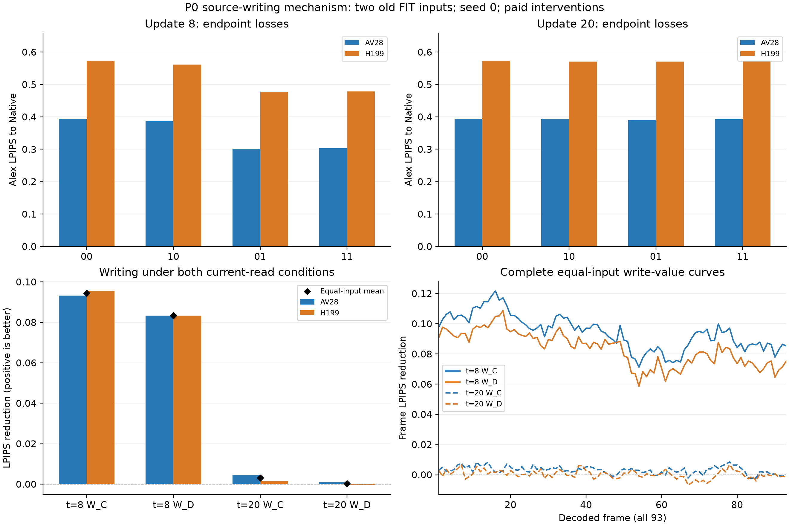

# P0两状态完整结果与V1后续推进

P0已经完整验收，写入带来的终点增量呈明显状态差异：保持当前C读出、只更新缓存时，第8步平均LPIPS降低19.51%，第20步降低0.64%。在已有Dense当前读出的条件下，第20步写入几乎没有平均增量，Human199有轻微负收益。这支持按状态估计刷新价值，保留来源生命周期感知规划作为V1；自动计划的有效性仍由P1完整视频决定。

## 设计与完整验收

同一Cosmos/UniPC/CFG7、35步请求/36次真实更新、Uniform19父计划，两旧FIT、seed0。第8步为首个合法C/C，第20步为中点后首个C/C；均按动作结构预登记，未按误差挑点。四格00/10/01/11分别拆分当前输出与完整缓存写入，latent和全部UniPC历史随当前读出，两个CFG分支的完整缓存/来源/窗口/工作状态随写入。

第8步原8对直接复用；新第20步14条物理请求包括8科学四格、4独立控制、2 fresh Native，共512个物理pair。完整14/14、四组全latent/93RGB等价和两Native跨批桥通过，新增8对CPU评分全部接受；合并后16科学位置，仍只有两个独立输入。原M1未重跑、未重评、未重结算。

[完整接受](../reports/cara_v1_P0_two_position_complete_acceptance_r1_20261102.json) · [完整分析](../reports/cara_v1_P0_two_position_complete_analysis_r1_20261102.json) · [原新8对评分](../reports/cara_v1_P0_point20_final_scores_accepted_r1_20261101.json)

## 终点结果

Alex LPIPS越低越好，输入等权。`W_C=L00−L01`、`W_D=L10−L11`，正值表示写入降低参考误差；最后一列为输入等权W_C除以输入等权L00。

| 更新位置 | L00 | L10 | L01 | L11 | W_C | W_D | 只写入相对下降 |
|---|---:|---:|---:|---:|---:|---:|---:|
| 8 | 0.483676328 | 0.473919125 | 0.389308134 | 0.390621907 | 0.094368195 | 0.083297218 | 19.5106% |
| 20 | 0.483676328 | 0.482341311 | 0.480590766 | 0.482012259 | 0.003085562 | 0.000329052 | 0.6379% |

| 更新位置 | 输入 | W_C | W_D |
|---|---|---:|---:|
| 8 | AV28 | 0.093229842 | 0.083298767 |
| 8 | Human199 | 0.095506547 | 0.083295669 |
| 20 | AV28 | 0.004552059 | 0.001062186 |
| 20 | Human199 | 0.001619066 | -0.000404082 |

W_C在4/4输入状态为正；W_D在3/4为正。第20步的正交互平均0.002756511，抵消了大部分只写入增量；Human199在Dense读出条件下的写入增量为−0.000404082。写入并不保证在所有当前读出条件下改善终点，不能只选一个有利差值解释机制。

[PDF](../reports/cara_v1_P0_two_position_figures_r1_20261102/P0_two_position_write_values.pdf) · [四个输入状态的全93帧CSV](../reports/cara_v1_P0_two_position_figures_r1_20261102/all93_per_input_effects.csv) · [输入等权93帧CSV](../reports/cara_v1_P0_two_position_figures_r1_20261102/all93_equal_input_effects.csv)

## 来源消费与解释

原第8步写入的直接C消费者为9–15、17、18，D19后从最近两来源中替换；新第20步写入在两个CFG分支中均被C21读取，D23后替换，符合预登记的动作结构预测。完整缓存一直保留三个物理槽和工作状态，不能把两来源代理误当成只保留两个张量。

这两个位置同时改变噪声阶段、来源年龄/间距和未来消费区间，因此不能将约30倍的W_C差异单独归因于消费者数量；来源替换后，因果影响仍可通过latent和采样器历史继续传播。P0建立写入有实际终点作用及明显条件依赖；P1仍需通过同阶段/当前年龄、不同前来源间距的采集与消融验证双来源信息的增量。

## 执行与费用

新P0于11月2日01:24:19开始、02:53:12结束，原GPU/工件CPU/评分CPU均退出，锁释放、Default恢复。新GPU实际1.481354486595115GPUh已唯一结算，低于1.95硬限。原第8步1.50062026643246GPUh原样保留，两个P0合计2.9819747530275746GPUh，仅作已付费用汇总，不重复收费。

cap226与旧16.5责任保持；本次结算后已用197.02183603468436、保留16.5、可用12.478163965315645GPUh。这是原结算快照，下一张卡仍须实时核验。半程p0-20-2、终验p0-20均已删除。

[原释放接受](../reports/cara_v1_P0_point20_final_release_accepted_r1_20261101.json) · [原唯一结算](../reports/cara_v1_P0_point20_final_settlement_r1_20261101.json)

## V1的下一项交付

等待期间已完成[原缓存标量到规划CLI的Linux CPU组件](843_CARA_V1_SOURCE_SCALAR_COMPLETE_LINUX_CPU_ACCEPTANCE_20261102.md)：13控制、32完整tiny请求、128同状态标签，带shadow父请求与普通父请求最终latent/mock RGB逐值相同，原UniPC数据无关数值尺度已一次保存。R1/R2失败保留，R3原容器退出0。组件证明接口和隔离，真实Cosmos标签、生成计划及完整视频效果仍待。

继续补齐完整P1生产组合：64标签采集、三种固定估值/同DP/19D与22D各top3、完整FIT选择及旧CHECK观察、Uniform/F19-C/F19-A1/原冻结搜索强对照，以及同LPIPS目标、同实测校准费用限制的新19D/22D搜索。旧控制器硬编码19D、额外保护24和RGB MSE，新LPIPS比较不能直接套用它；旧赢家不重选。

完整P1初算8.5749GPUh，含20%余量约10.2899；正式范围、CPU入口、实际开销和硬限尚待冻结。按用户已选方向，P0先完成、完整P1另审预算，不拆卡规避门槛，也不自动启动。P1需证明来源信息有增量、自动19D有竞争力且同程序22D有效；真实完整视频过门后才冻结方法并登记新DEV。V2完整伴随后置，保护16/备用16及旧A32/B36/S/Q/搜索冻结保持。
