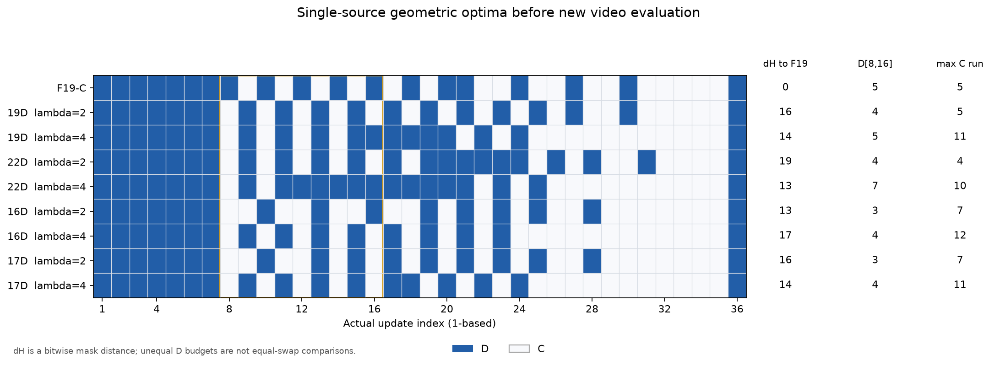

# 单来源阶段覆盖：强参照、远Uniform检查与合并准备

**补充零GPU检查支持继续研究阶段加权单来源覆盖。** λ=2、4下，F19-C和旧RGB-MSE赢家均排在44个纯C布局的第1、第2；在同为19D的23个布局内也保持第1、第2。剔除近Uniform计划后，排序相关仍保持。主方法转为单来源估值，不再以双来源额外增量承担主张。

本次只使用[已取回的原42查询](../reports/cara_source_coverage_P1_original42_score_returns_r1_20261103.json)及原两条强参照，没有新视频、指标重算、模型推理、GPU或账本访问。[完整机器审计](../reports/cara_phase_coverage_robustness_zero_GPU_r1_20261103.json)与[复核CLI](../scripts/audit_cara_phase_coverage_robustness_r1.py)保留全部四个lambda和所有过滤阈值。

## 强参照到底排在哪里

几何排序均为单来源的“峰值、平方和”字典序，越小越好。跨D配额的44布局排名按用户问题照实给出，判断优先使用同19D的23布局排名。

| lambda | F19-C / 全44 | RGB-MSE赢家 / 全44 | F19-C / 同19D的23 | RGB-MSE赢家 / 同19D的23 |
|---:|---:|---:|---:|---:|
| 0 | 24 | 39 | 12 | 20 |
| −2 | 32 | 43 | 19 | 22 |
| 2 | 1 | 2 | 1 | 2 |
| 4 | 1 | 2 | 1 | 2 |

所以正lambda的信号覆盖了这两条强布局，不只是对Uniform邻居内部排序。原局部误差代理的完整负相关和本次几何目标是不同估值器，其[原42查询对照](../reports/cara_source_proxy_saved42_CPU_audit_r2_20261103.json)不改写。

## 远离Uniform后是否保持

汉明距离dH按36位D/C mask逐位计数；在相同D配额内，dH=6等价于至少3次D/C交换。主检查固定dH≥6，同时报告0、2、4、6、8、10、12全部阈值。过滤只依据mask距离，不看LPIPS。下表只使用原查询，未把F19等强参照加进去抬高相关。

| D预算 | 最小dH | 计划数 | lambda=0 | lambda=−2 | lambda=2 | lambda=4 |
|---|---:|---:|---:|---:|---:|---:|
| 19 | 0 | 21 | 0.6104 | 0.0286 | 0.9636 | 0.9675 |
| 19 | 6 | 15 | 0.6786 | 0.1071 | 0.9679 | 0.9357 |
| 19 | 8 | 12 | 0.5385 | −0.1049 | 0.9441 | 0.9091 |
| 22 | 0 | 21 | −0.2727 | −0.5935 | 0.7481 | 0.9182 |
| 22 | 6 | 18 | −0.2136 | −0.4386 | 0.6450 | 0.8927 |
| 22 | 8 | 16 | −0.2353 | −0.4647 | 0.5971 | 0.8706 |

机器审计同时保存逐输入相关、距离直方图和加入强参照后的敏感性结果。过小子集保留其分母，少于3条不估计相关；不挑一个最有利过滤阈值作为新主结果。尤其22D的lambda=2在远距离子集上有所减弱，lambda=4更稳定，两个设置均如实报告。

这些始终是同两个旧FIT上的开发诊断，计划之间包含自适应搜索关联。它们支持下一步投资，不承担论文的独立方法证据。P0的8/20位置还同时改变来源年龄、后续消费与solver状态，不能单独证明高噪声就是写入价值的因果变量。

## 几何最优计划的实际形状

| D配额 | lambda | 与F19的dH | D[8,16] | 最长连续C |
|---|---:|---:|---:|---:|
| F19 | — | 0 | 5 | 5 |
| 19 | 2 | 16 | 4 | 5 |
| 19 | 4 | 14 | 5 | 11 |
| 22 | 2 | 19 | 4 | 4 |
| 22 | 4 | 13 | 7 | 10 |
| 16 | 2 | 13 | 3 | 7 |
| 16 | 4 | 17 | 4 | 12 |
| 17 | 2 | 16 | 3 | 7 |
| 17 | 4 | 14 | 4 | 11 |

不同D配额的dH不能直接解释为相同次数的交换。完整mask见[CSV](../figures/cara_phase_coverage_robustness_r1_20261103/optimal-layouts.csv)和[新候选池](../plans/cara_next_stage_20261103/source_coverage/c1/PHASE_SINGLE7_CANDIDATE_POOLS_R3.json)。

正阶段权重产生了不同于F19的计划；lambda=4还会把更多刷新移到早期，留下较长的尾部C区间。因此F19在旧布局中的第1名不能代替新几何最优计划的真实视频。这正是保留lambda=2/4两族和lambda=0控制、再做终点评价的理由，现阶段不按最终LPIPS调整mask。

## 新7候选的定义与CPU依据

原生成器取“同一最小峰值内、按平方和排序的最多三条”，19D下lambda=2、4实际上各只有一条。新设计按用户意见各取前三名时，必须允许第二、三名使用更高峰值，否则不能产生7个不同候选。

[新单来源DP](../src/wcomr/cara_phase_coverage_topk_r1.py)明确优化完整计划的全局字典序`(峰值, 平方和, mask)`：用饱和路径计数定位前k条计划的峰值，再在每个峰值下做带“确实达到该峰值”状态的能量DP，避免前缀峰值被后缀抹平时错误剪枝。最优第一名与原程序一致，第二、三名可跨峰值。

据此登记19D的lambda=2前三名、lambda=4前三名、lambda=0第一名，共7个不同候选。16D、17D、22D也各生成7条CPU库，但合并GPU草案只评估16D/17D各自lambda=2/4的第一名，共四条快速布局；22D不跑GPU。这是看过原42查询后形成的新开发设计，旧库和原结果均不改写。

新增[4项CPU控制](../reports/cara_phase_single7_merged_local_CPU_r1_20261103.json)通过，含120组独立穷举全局前三名核对，其中61组前三名跨不同峰值；四配额原最优第一名一致、每库7条不同mask、11个评估布局的C/A1身份与D位置一致、预算不足不产生执行权限。单来源指估值只看最近D；真实C读出仍沿用原完整缓存和UniPC状态。

## 合并范围与真实报价

[合并审阅](../plans/cara_next_stage_20261103/source_coverage/c1/PHASE_SINGLE7_MERGED_PROPOSAL_R3.md)和[机器草案](../plans/cara_next_stage_20261103/source_coverage/c1/PHASE_SINGLE7_MERGED_PROPOSAL_R3.json)保留：19D七条、16D/17D各两条，所有11个GPU评估候选都在两个FIT生成C和A1；19D/快速档的固定FIT赢家各在两个CHECK验证C/A1；快速赢家另做四条light-C+A1；同费用19D搜索、三个同批参考、预热和原/轻量入口控制。

完整上界为**106请求、23内部双FIT查询、68个去重后的报告位置**，预计**9.2406 GPUh，建议硬限9.25**。它包括全部C/A1、控制、600秒释放和15%波动余量；16/17D及light-C也按原19D实测最大费用报价，不预支速度收益。相同范围若拆成两卡，多一套参照/控制/装载释放，约多2.4405 GPUh。

因此合并确实节省费用，但“全部候选C/A1＋16/17D＋搜索”不能继续按7–8 GPUh报价。9.25与Shared25规划10合计19.25，低于最后余额19.2743快照，余量0.0243 GPUh。是否无需追加还取决于Shared25正式范围能否保持在10内以及实时账本；本轮未刷新账本或实际预约，不自动增cap。

19D保留已同意的1.15质量比、1.05时间比、优于同费用搜索及90%–100%实耗匹配条件；快速档新增的是**同批Native T_DD / 候选T_DD≥1.9**、LPIPS≤0.30以及三项质量门。1.9是速度比，不是让T_DD本身变大；0.25作为期望观察值，不替代0.30继续线。旧P1的1.10判定保持。

主方法的19D C校准与全C/A1表征成本分开列出，不能把未参与C选择的A1生成费用变成搜索额度。质量门沿用MUSIQ 1原分、主体/平滑0.01的容忍界，明确绑定本卡Native/F19-A1参考；三质量CPU环境和完整106入口还待正式组合验收，不用旧166或70的CPU接受冒充新范围。

当前工作是零GPU核验、候选登记与合并准备；没有新视频分数或GPU启动批准。Shared25的独立确认是其自身证据，不能替代新几何方法冻结后的新输入验证。最终/备用保护池、所有旧冻结、WC/RA FIT UNMATCHED与旧CAL曝光范围保持。
