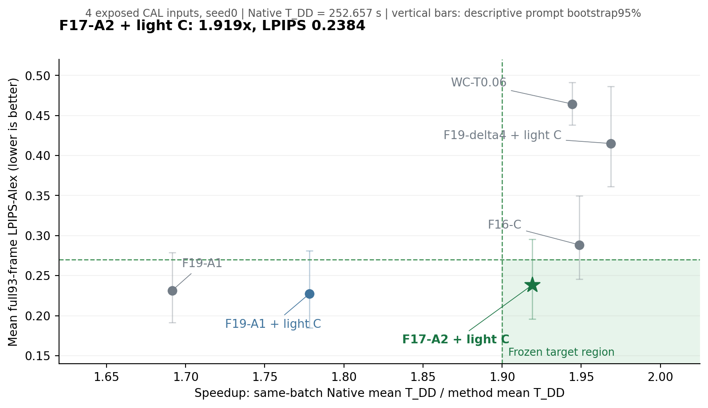
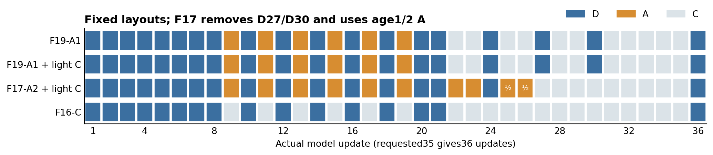

# F19 小 CAL 完整结果：F17-A2＋轻量 C 达到1.919×、LPIPS0.2384

**本轮目标在四个旧CAL的预登记均值门上达成。** F17-A2＋轻量C的T_DD为**131.6526秒、1.9191×**，平均全93帧LPIPS-Alex为**0.238368**，相对Native和原F19-A1的三项质量门均通过。相比原F19-A1，省17.7085秒（11.86%），LPIPS增加2.97%；相比同批WC_T006，耗时慢1.31%，LPIPS低48.67%。这是本轮唯一同时通过全部固定目标的方案。

[完整接受](../reports/cara_f19_speed190_complete_r1_20261103/complete_acceptance.json)与[完整分析](../reports/cara_f19_speed190_complete_r1_20261103/complete_analysis.json)保存七方案、全部质量差值和描述区间；[原始采集](../reports/cara_f19_speed190_complete_r1_20261103/original_collection.json)、[原始评分](../reports/cara_f19_speed190_complete_r1_20261103/original_scores.json)、[释放结算](../reports/cara_f19_speed190_released_lifecycle_r1_20261103.json)与[固定卡片](../plans/cara_next_stage_20261103/f19_speed190_cal/CAL35_MANIFEST_R1.json)可逐项追溯。

## 同批七方案

四输入等权、seed0；T_DD是去噪循环开始至解码完成，T_request保留完整请求开销。表中只汇总28条正式路径，预热、等价控制、诊断和两条计时复测分别保留。质量列要求三维度相对Native、F19-A1的六项均值差值均通过。

| 方案 | T_DD 秒 | T_DD提速 | T_request 秒 | LPIPS-Alex | 三项质量门 | 整体目标 |
|---|---:|---:|---:|---:|---|---|
| Native35 | 252.657 | 1.000× | 314.536 | 0.000000 | 通过 | 未达 |
| WC-T0.06 | 129.945 | 1.944× | 192.546 | 0.464343 | 未过 | 未达 |
| F19-A1 | 149.361 | 1.692× | 212.389 | 0.231499 | 未过 | 未达 |
| F19-A1 + light C | 142.079 | 1.778× | 205.372 | 0.227395 | 通过 | 未达 |
| F17-A2 + light C | 131.653 | 1.919× | 195.803 | 0.238368 | 通过 | **达标** |
| F19-delta4 + light C | 128.333 | 1.969× | 191.311 | 0.415019 | 未过 | 未达 |
| F16-C | 129.656 | 1.949× | 192.254 | 0.288512 | 未过 | 未达 |

固定成功线为**提速≥1.9且T_DD≤133秒，平均LPIPS≤0.27，三项质量门全过**。F17的完整请求提速为1.6064×；1.9191×对应T_DD口径。WC与F17是接近耗时的同批观察点，不改写旧WC FIT UNMATCHED标签，也不宣称两个时间完全相等。

## 三条路线给出的答案

**① 轻量C有用，单独还不够1.9×。** 保持F19布局和原A1，T_DD从149.361降至142.079秒，省7.282秒；LPIPS从0.231499降至0.227395，四输入中3个下降，三项质量门均过。因原F19有19D、6A、11C，真正可直接压缩的是11个纯C，不能把全部17个非D都当成纯C。

**② 删尾部两次D＋A2＋轻量C使组合达标。** F17删除D27/D30，保留早段8–16的D位置。相对F19＋轻量C再省10.427秒，总计省17.709秒。该差值检验的是删D、A2和轻量读出的组合，不单独归因于其中一项。F16纯C控制虽有1.949×，LPIPS为0.288512，MUSIQ和主体一致性均未过门；不能因低于0.30就把固定0.27线改掉。

**③ 本轮不采用CFG单支刷新。** 仅在D10/14/18/21计算条件支，保持来自最近真实DD8/12/16/20的两支差分；同时用轻量C，确实达到1.969×，但LPIPS升至0.415019，MUSIQ/主体质量也未过。[既有真实B1保存张量检查](../plans/cara_next_stage_20261103/f19_zero_gpu/REAL_B1_RESULTS_R2.md)支持了局部误差假设与本次试验，未转化为自由运行整段视频的保真；本卡不足以把失败唯一归因于某个步或CFG倍数。

## 达标布局与读出

F17为**17D＋10A＋9C**，D位置为`1,2,3,4,5,6,7,8,10,12,14,16,18,20,21,24,36`；A位置为`9,11,13,15,17,19,22,23,25,26`，其中25/26的alpha为0.5，其余A为1。C在27–35。轻量C读出为当前embedding加最近真实D残差，跳过当前浅层探针、OSI/光流/显著性；A保留当前浅层信息。末步36仍完整计算。

角色/布局的完整字节身份留在固定manifest；编译时的准备标志不作为当前执行状态，实际接受由原GPU/CPU回执和本轮完整接受文件确定。

## 原C成本的真实拆解

单条F19诊断路径的11个C，配对去噪区间共7.4325秒，**约0.6757秒/纯C**；其中两支各两层探针约0.4799秒/配对C，光流0.0749秒、warp0.0661秒、两输出头0.00684秒。单条D配对区间约6.8595秒，A约0.8525秒；36次solver更新合计0.07353秒，VAE解码6.3783秒。

这些是当前CUDA流的嵌套包含区间，不能相加当成互斥核开销。轻量C省7.282秒是四正式输入的完整T_DD差值，未以差分反推出一个未经单独profile的“轻量C绝对价格”。原估计的“纯C约1秒、可省约10秒”应更新为这一组实测。

## 质量门与逐输入

质量越高越好；预登记容忍为MUSIQ1原分、主体/平滑0.01。以下均值门全部通过；95%区间是四旧CAL提示词的精确自举描述，不能解释成独立输入上的95%非劣保证。

| 参考 | 指标 | F17差值 | 固定容忍下界 | 描述性95%区间 | 点门 |
|---|---|---:|---:|---|---|
| NATIVE35 | MUSIQ_LONGER512 | -0.466251 | ≥-1.00 | [-1.215239, +0.282737] | 通过 |
| NATIVE35 | subject_consistency | -0.004505 | ≥-0.01 | [-0.014929, +0.005920] | 通过 |
| NATIVE35 | motion_smoothness | -0.001136 | ≥-0.01 | [-0.003086, +0.000434] | 通过 |
| F19_A1 | MUSIQ_LONGER512 | +0.630900 | ≥-1.00 | [+0.073189, +1.133461] | 通过 |
| F19_A1 | subject_consistency | -0.000893 | ≥-0.01 | [-0.005613, +0.004465] | 通过 |
| F19_A1 | motion_smoothness | +0.000779 | ≥-0.01 | [+0.000469, +0.001000] | 通过 |

原F19-A1相对Native的MUSIQ为−1.0972，略低于−1的固定线；轻量F19和本轮F17通过该门，未因此调整判据。

| 输入 | F19-A1 | F19＋轻C | F17-A2＋轻C | 单支＋轻C | F16-C | WC_T006 |
|---|---:|---:|---:|---:|---:|---:|
| av_28b7cf08-cfb8-41e4-8b1b-d669aa69e632 | 0.190976 | 0.189756 | 0.201281 | 0.349219 | 0.253182 | 0.464265 |
| human_199 | 0.235375 | 0.228427 | 0.234836 | 0.397875 | 0.280731 | 0.501385 |
| misc_13398218_3840_2160_60fps | 0.307827 | 0.311305 | 0.326826 | 0.516716 | 0.382222 | 0.462142 |
| av_51b45829-502e-4143-9c32-c026bd6ab191 | 0.191819 | 0.180091 | 0.190529 | 0.396266 | 0.237912 | 0.429578 |

F17在4/4输入上LPIPS低于WC；`misc_13398218`为0.326826，说明本轮0.238368是四输入均值，不是每个输入都低于0.27。全部均为已曝光旧CAL（2FIT＋2旧CHECK）；独立新输入确认仍待，保护池未用于本轮选择。

## 完整验收、费用与后续

- 原GPU全部35路径、1260配对更新完成；两条控制的全部36引导张量及终态latent完全一致。35条全93帧RGB、控制/重复RGB、24对LPIPS和84个原始质量评分完成，原CPU退出0、CUDA未初始化，三模型顺序释放。未重放GPU或旧指标。
- 正式与复测共30条clean路径均无引导复制、内容哈希或研究checkpoint进入计时；profile单列。最后一个输入上Native复测比初次+0.0786%，原F19为−0.0167%。F17没有新增专门复测。
- 原guardian/CLI/supervisor/runner全部结束，两个锁释放，Default恢复；3710条原监测记录温度45–88°C，独占上下文始终为原runner。完整单调时钟费用**2.240264355GPUh**已唯一结算，低于3GPUh硬限；CPU评分4861.35秒，2核/8GiB/无GPU，约2.70075vCPUh，界限6小时。
- 本卡结算后cap250、used216.465985066、旧责任reserved16.5、可用**17.034014934GPUh**。继续保留Shared25独立确认规划10，余7.034014934。C1合并草案9.25＋Shared25规划10合计19.25，按现余额缺**2.215985066GPUh**；旧19.2743快照不能再证明两者可同时覆盖。草案本身和历史预算不改写，没有授权新派发或增cap。

本轮应保留F17-A2＋轻量C为达标CAL工作点、保留轻量F19为较保守读出对照，停止把单支刷新当作当前保真方案。接下来可准备新输入确认和更新剩余报价；本报告不自动启动确认卡、C1或Shared25。

运行身份：`cara-F19-speed190-CAL35-r1-20261103`；launch`f17bfbf0d188491a8821bb65604cb679`；GPU源码`ee105ecb3f3ab8a7e7e348ef275f5d4bf3cd34c9`；scope`8bd653646deb3d22a4c5b32824c2991fde70a129f0a050ce03c59b8406baa367`。全35视频和四份控制张量留在服务器原私有卷，路径、大小和SHA均在原采集文件中；权重和大张量未入Git。
