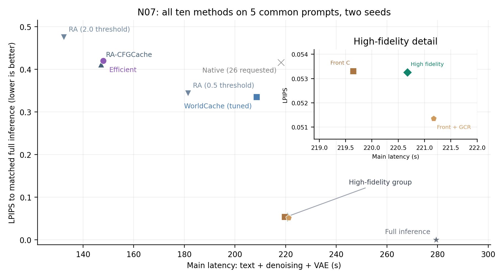
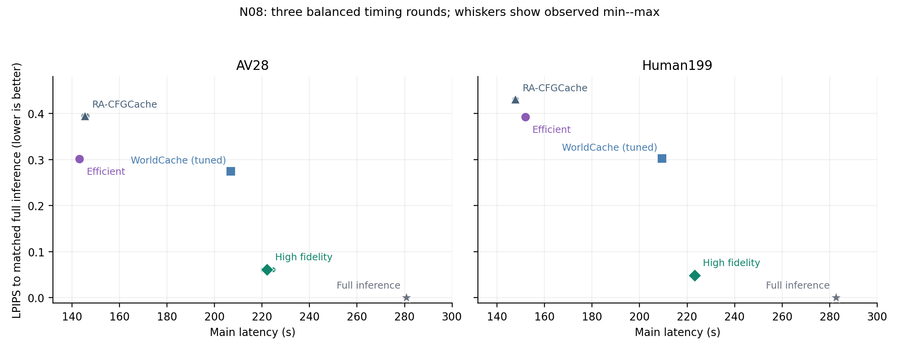

# 已接受结果的论文图表数据包：N07与N08

日期2026-10-17。图表展示低费用与高保真两个工作点以及简单调度对照；所有数据从已接受原件重算，来源与SHA见provenance.json，完整数字见data.json。内部ID始终保留，Efficient对应A_NO_P，High fidelity对应TABLE_PHASE_H1；论文工作名称沿用总映射。

## 文件与阅读顺序

- [N07原19项配对表](N07_paired_results.md)：18个原比较＋前密A/C次级比较；分别列质量共同队列、原主时间队列与同质量队列倍数。
- [N08逐场景三轮表](N08_repeated_results.md)：全部30正式计时、每轮秒数、均值/SD/最小最大、逐场景LPIPS以及Native/WC/RA基线除以候选。
- [N07共同队列图](N07_common_cohort_quality_time.svg)：十方法全部可比的5提示词×双seed，按可用性选队列，图为次级同队列可视化；原8提示词的拒绝与缺失在data.json保留，全8均值仍为空。
- [N08重复测速图](N08_repeated_quality_time.svg)：两个旧CAL分别显示，误差线为三轮观测最小/最大值；重复次数不当作独立提示词数。
- data.json保存全部双seed提示词矩阵、19项完整配对、30原始计时和源文件SHA。N12/N10未完成结果留空。

## 计时与质量口径

主计时为文本编码、去噪、VAE及在线缓存更新/修正/刷新。请求安装、边界GC、清理、模型加载、guardrail和写盘按原记录另列，N08每轮分量也保存在data.json。整卡GPU账单包含加载和预热等，不能替代单视频延迟。

N07每配置/seed一次正式计时，N08固定相同输入三轮平衡计时。两批分别使用自身匹配原生参考的93帧LPIPS；LPIPS刻画接近原生视频的程度，物理/语义质量补充由N10另测。N07共同5提示词图不改变原配对表的5/6提示词统计，也不将旧CAL计时替代新输入质量证据。图中无方法点插值或推断的Pareto连线。

## 可用英文图注

**N07.** Latency--fidelity trade-offs for all ten frozen N07 methods on five common prompts with two seeds each. Video LPIPS is averaged over both seeds and then equally over prompts; latency uses the same cohort. The inset resolves the high-fidelity configurations. This all-method visualization uses complete cases from the eight-prompt registered set; the original pairwise tables retain their respective available cohorts and all refusals.

**N08.** Repeated main latency and reference fidelity on two calibration scenes. Markers show three-round mean timings; whiskers span the observed minimum and maximum, with individual timings shown faintly. All three rounds reproduce the same accepted output for each method and scene. Main latency covers text encoding, denoising, VAE decoding and online cache computations; request setup/cleanup, initialization, guardrails and writing are recorded separately. Speedup is matched baseline time divided by candidate time.

## 复现

从仓库根运行 `MPLCONFIGDIR=/tmp/wc-paper-mpl .venv/bin/python scripts/export_wc_paper_accepted_figures_r1.py --output-dir 一个不存在的新目录`。脚本禁止覆盖既有输出；读取已保存原件，不查询服务器、不加载模型、不生成新视频或质量分数。图源为Matplotlib标准科学绘图，SVG可编辑、PNG供预览。
