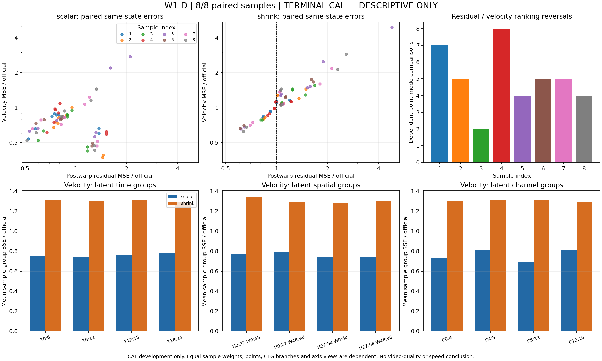

# W1-D CAL8：scalar机制信号，进入固定跳步闭环

2026-09-30；run `w1d-cal8-r1`；源`62f1c0d03ab7d789a7e5a86235e2d27cf920825c`。决定：继续WorldCache主线，用已冻结scalar-recent检验固定schedule闭环；shrink0.5在本CAL8范围不进入闭环。尚无新方法质量或加速收益。

## 完整终态与技术验收

8/8原定场景全部尝试，OFF/ON各8接受，0安全拒绝/未知异常；每样本四对、8诊断点，共64依赖状态。每对17项技术检查全真：72模型输出、部署block计数/trace、最终cache、latent/pipeline/rawdecode/guardrail、decoder identity/flags、MP4与全部93帧RGB、点选择、过去anchors、有限数值及flags恢复均满足协议。每样本OFF trace先冻结位置，当前truth仅评分，不写入部署或校准状态。接受只表示安全管线接受，不是质量合格。

监督器/timeout/runner原PIDs2461004/2461009/2461011已退出；exit0，无stop reason；锁可用，GPU1释放至24MiB/noapps。16视频在服务器重新哈希匹配；源码哈希匹配；699次GPU监控未观察到其他compute PID，采样显存峰值31,642MiB。见[原始runner](../reports/w1d_cal8_r1_runner.json)、[监督器](../reports/w1d_cal8_r1_supervisor.json)、[终态审计](../reports/w1d_cal8_r1_audit.json)。此前live/partial文件为历史快照，不代表最新状态。

## 冻结筛查结果

下表每样本值为所选8点candidate MSE之和 / official MSE之和；整体以样本等权均值汇总。CFG点、latent组与帧不作独立样本。不按异常场景替换或补样本。

| CAL样本 | scalar velocity比 | scalar postwarp比 | shrink velocity比 | OFF full/skip |
|---|---:|---:|---:|---|
| AV 28b7cf08 | 0.725114 | 0.792090 | 1.039376 | 34/38 |
| common 6487f37f | 0.607166 | 0.848467 | 1.225236 | 35/37 |
| human_199 | 0.627431 | 0.791489 | 1.225666 | 38/34 |
| industry_084 | 0.772380 | 0.790936 | 1.071303 | 34/38 |
| misc_13398218 | 1.204467 | 1.315187 | 1.974965 | 40/32 |
| physics_045 | 0.600274 | 0.881886 | 1.276861 | 32/40 |
| robot_054 | 0.773330 | 0.893112 | 1.285557 | 34/38 |
| AV 51b45829 | 0.763317 | 0.836265 | 1.350649 | 34/38 |
| 等样本均值 | **0.759185** | **0.893679** | **1.306202** | 每样本72calls |

scalar在7/8同时改善velocity/postwarp，平均velocity MSE降低24.0815%、postwarp降低10.6321%，0fallback；满足生成前固定的≥6/8联合改善及两个均值比<1规则，输出**MECHANISM_ONLY_CAL8**。shrink0/8改善velocity，postwarp均值比1.243757，0fallback；当前冻结收缩线不继续闭环或无依据调参。[机器汇总](../reports/w1d_cal8_r1_summary.json)仅给scalar一个机制信号，未作CONF/PROMISING判断。

misc样本两种指标均恶化，必须保留在后续同批闭环；不得以均值掩盖失败。旧单AV工程四点的默认/recent NO_GAIN_IN_SCOPE保持原范围；新CAL8更换了场景及冻结的时间覆盖，不是同一实验的重复，也不能把旧负结果改写成正结果。

## W1-D分布与排序

8样本均观察到残差-versus-velocity排序反转，共40个点—候选对对比；同一点可涉及多个候选对，这40不是独立样本/统计检验。scalar各velocity组等样本比：时间0.744–0.782，2×2空间0.738–0.791，channel0.695–0.807；每个组都7/8样本改善。没有平均组上“仅一个局部组有效”的模式，当前优先检验简单全局scalar闭环，不先增W2复杂度。排序差异是本模型内部误差的描述，未证明对应的视频物理损害或因果。

[分布原始汇总](../reports/w1d_cal8_r1_analysis.json)按显式residual BTHWD/velocity BCTHW布局，校验group面积/不重叠/完整覆盖以及group weighted MSE/reference energy重建整体值；先样本内SSE归约，再样本等权。坐标是latent time/space、hidden-feature或latent channels，不是解码像素/物理量。图中sample1–8对应上表顺序；两scatter共用轴界限，各group图共用纵轴。

## 成本与下一步

监督wall **3590.173902秒 = 0.997270528GPUh**，包含初始化/加载/失败保护/diagnostics/flush；累计**2.995044843/4h**，余**1.004955157h**。8OFF总1592.147秒，8ON总1810.916秒，差218.768秒；点内diagnostic记录合计232.970秒。两种计时口径不同且有顺序/波动，不能用差值作严格因果开销或部署测速。[预算](../reports/budget.json)已结算。

下一有界任务见[固定schedule准备卡](22_W1_REPLAY_PREPARATION.md)：共用此次8场景的OFF frozen trace；先第一场景新official replay复现旧OFF，再scalar OFF/ON自身轨迹parity，之后其余7场景scalar OFF，第一candidate OFF即8场景成员。最多3000秒从原余额扣除，不训练/付费评分/人评/调新参数。候选用自身当前latent/probe/真实full anchors，不能直接回放旧latent或注入shadow truth。runner尚待实现及Linux/实机gates；CPU模块不是已经跑过候选。固定schedule、视频差异和诊断时间都不足以形成最终质量—时间结论。

CAL为可复用开发数据，源录制/语义独立性未证，DEV/CONF尚未冻结；该机制信号不替代独立确认或调优WC/强基线比较。
