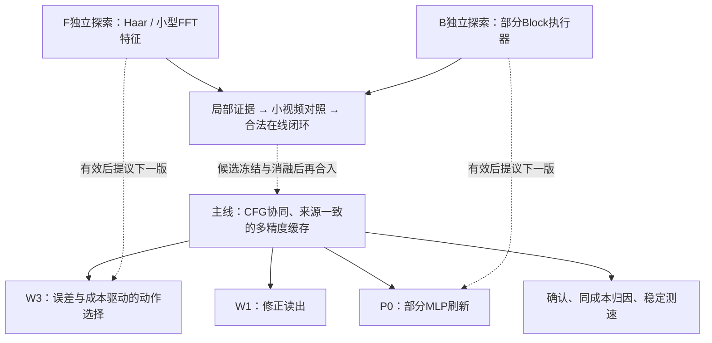

# WorldCache 当前主线与独立探索安排

**最新执行覆盖（2026-10-14 15:15）：** 原B312已在运行，17:45一次验收；此后按用户要求不新开任何实验，转最终收束。下文未启动/自主后续描述是此前快照，参见[422](422_WC_B_FULL312_LAUNCH_AND_FINAL_COLLECTION_ONLY_20261014.md)。

更新于2026-10-14。依据完整结果374/380/392/396/403/410/412/417，以及420原60完整验收整理。**主线继续；F/B作为独立开发分支，有真实收益后再讨论并入下一版。** 本文是当前任务导航，旧结果、判据、失败和已冻结实验原样保留。实验状态以最近验收/启动回执为准，本次在原约定查收时间之后一次读取并验收原60，没有持续监听或重投。

当前以[420原60完整验收](420_WC_FULL60_COST_CURVE_COMPLETE_RESULTS_AND_CONVERGENCE_20261014.md)及[收束计划](../plans/WORLD_CACHE_PAPER_CONVERGENCE_AND_FINAL_EXPERIMENTS_20261014.md)为准：60/60接受，40正式全93帧；MID=FIXED_A的正式终态/动作/RGB，两个AV28预热对144guided逐位等价。固定A比plain均LPIPS低3.5196%、多0.8762秒，3/4改善；LOW=plain，HIGH四场景全93帧退化。三λ仍26D/0P、A0/5/7，不是宽范围费用曲线。原GPU/post已结束、锁/GPU释放，无在途；B312保持独立后置、CPU就绪未GPU。417四新提示词双seed确认及原RA拒绝分母继续保留。

[412完整F/B结果](412_WC_FB_COMPLETE_RESULTS_AND_INDEPENDENT_CONFIRMATION_LAUNCH_20261013.md)：F/B完整432已接受，F当前特征没有决策增量，B有局部状态相关省时，继续独立。其历史费用与确认启动快照保留在原报告，不作为当前账本。

[415独立B终点准备](415_WC_B_REAL_REFERENCE_AUDIT_AND_FULL312_PRODUCTION_PREPARATION_20261013.md)：原四点三臂（C_REPLAY／Dense速度／L2速度），4父＋12后缀／16视频，完整312pairs／624CFG；两flow数值CPU、四真实保存参考及730文件生产入口CPU已接受。预测2.236752758GPUh，尚未GPU；它只区分首次返回速度对终点的影响，首个真实缓存动作均为C，不验证B刷新来源或闭环加速。排在原CONF50和完整60曲线之后，F/B仍不并入主线。

[416 F决策边界分析](416_WC_F_DECISION_MARGIN_DECOMPOSITION_AND_NEXT_CPU_HYPOTHESIS_20261013.md)：旧16点RAW_SUB的标量误差下降中96.08%来自C/A共有误差，差值预测误差仅下降9.52%，三个原误选未跨过主档决策边界。登记直接预测传播加权动作收益差的CPU假设，尚未执行；旧五模型/三lambda/全部分母保持，主线不改。

## 1. 主线要解决什么

目标是 **CFG协同、来源一致的多精度缓存计算**：在质量与实际成本之间获得更好的选择，而不是要求每个配置同时比所有基线更快、更准。

|主线部分|现在实际做什么|还需回答的问题|
|---|---|---|
|W1 / A：怎样复用得更准|基于浅层信息修正读出；两CFG分支协调；D可信锚点与P工作来源分开，读出和误差标签对应同一来源|局部误差改善在哪些状态转化为视频收益？怎样保住已有A_NO_P/P_OFF正候选？|
|W3：怎样选择复用与刷新|当前H1按来源×阶段绝对guided MSE、传播gain²和实际动作费用选择C/A/P/D；支持域与保护规则独立记录|优于同成本简单规则吗？是输入自适应，还是一个更好的固定阶段策略？|
|P扩展：重算能否更便宜|现P0只在四层对50% token做部分MLP，attention全算；近似来源有出生误差，不能冒充D|计算覆盖、缓存维护和后续重算是否抵消节省？|

主线建立在WorldCache和RA基础上；普通CFG联合风险、缓存或部分token计算本身不单独宣称原创。方法工作集中在**实际读出、来源质量、动作误差与真实费用之间的一致性及其收益**。

## 2. 已完成证据：哪些值得保留

|证据|发现与价值|适用边界|
|---|---|---|
|[374干净20次计时](374_WC_CLEAN_SPEED20_COMPLETE_RESULTS_20261012.md)|原两场景、五配置、正反两轮的测速已完成；A_NO_P出现相对Native/WC的速度与保真正信号；同A加入P更贵、质量进一步改善|原测速问题已回答，不能把新方法待测速说成原20次未完成；不跨批次混算速度|
|[380原N2](380_WC_MATH_N2_COMPLETE_SOURCE_GATE_POSITIVE_AND_ROUTER_A_UNUSED_RESULTS_20261012.md)|A_NO_P与P_OFF是不同成本的有效开发候选；来源门控有终点价值|旧H1/H2实际A=0、保护/支持回退问题保留为历史，不代表当前H1|
|[392同状态16点](392_WC_SOURCE_PHASE16_COMPLETE_POSITIVE_RESULTS_AND_CONSEQUENCE_NEXT_20261012.md)|来源一致A在16/16点优于C；P来源旧D参考仅2/8改善，一致读出8/8改善|局部监督不是终点；16点是自然父轨迹状态，其中14个原动作C、2个原动作P，不能统称16个自然C|
|[396单次A后果](396_WC_PI0_SUFFIX8_COMPLETE_RESULTS_LOCAL_TARGET_AND_FUTURE_COMPUTE_20261013.md)|AV28 LPIPS改善0.9812%，后续D+P由8到7；另外三点轻微退化，说明局部与终点需分别评价|取证计时、解码顺序效应保留，不据此宣称干净加速|
|[403完整新版H1](403_WC_ABSOLUTE_H1_COMPLETE_RESULTS_HIGH_FIDELITY_AND_NEXT_20261013.md)|36路径含12预热，24正式视频全93帧、全部控制完成；来源×阶段H1形成明显高保真工作点，A真实进入调度|四CAL、seed0、每格一次正式计时；不是独立确认或同成本优势|

403同批四场景等权结果：

|方法|平均主时间 / 秒|平均LPIPS ↓|目前用途|
|---|---:|---:|---|
|Native|283.2453|0|匹配原生参考|
|RA|147.0678|0.418610|强基础对照|
|A_NO_P|150.1533|0.378145|低额外成本修正锚点|
|P_OFF|156.7080|0.357051|进一步改善保真的锚点|
|TABLE_PHASE_H1|223.6088|0.058593|高保真候选|
|TABLE_POOLED_H1|151.4122|0.402727|来源池化消融|

H1比Native快 **1.2667×**；相对P_OFF失真下降 **83.5898%**，平均多 **66.9008秒**。这是值得确认的质量—时间工作点。四场景H1却采用同一序列：1–24步D，25–29步A，30步C，31步D，32–35步C，36步D，即 **26D/0P/5C/5A**。因此最大的未解问题是**更好读出与刷新选择的独立价值、可泛化性和真实成本**；不能把它写成四动作都已发挥作用或内容自适应成立。

LPIPS表示接近匹配Native的程度；旧MUSIQ/VQA混合证据继续保留。帧覆盖不是跨场景样本量，保真不等于物理质量。

## 3. 主实验队列：不因新探索改动

|顺序|任务|当前状态与完整范围|主要回答什么|
|---|---|---|---|
|已完成目标对齐控制|[410 teacher完整结果](410_WC_TEACHER_FIRST_COMPLETE_RESULTS_AND_TARGET_ALIGNMENT_20261013.md)|原4父＋8后缀＋4离线teacher pairs、270pairs/540CFG、12视频全93已接受；独立重算2正/2负场景，teacher相对C平均失真降低0.2077%，比单次A在3/4更低|当前完整teacher速度并不保证终点改善；两首C缓存相同，P点的局部速度/完整刷新状态价值需要区分|
|已完成独立确认|[405冻结H1](405_WC_FROZEN_H1_INDEPENDENT_CONFIRMATION_FULL50_FINAL_PRODUCTION_PREREG_20261013.md)／[417完整结果](417_WC_FROZEN_CONFIRMATION_FULL50_RESULTS_AND_COST_CURVE_NEXT_20261013.md)|四新提示词×seed17/43×五方法，40正式＋10预热；全部50终态、39兼容正式全93帧评分接受；RA Human seed17视频拒绝保留。H1八视频全部完成、LPIPS0.053036807，比P_OFF低84.6018%，Native加速1.2681×|冻结候选在新输入/seed上形成高保真工作点；仍是同26D/5A/5C序列，不证明内容自适应或同RA费用优势|
|已完成|H1同mask/读出消融与实际成本曲线|[420完整结果](420_WC_FULL60_COST_CURVE_COMPLETE_RESULTS_AND_CONVERGENCE_20261014.md)：原60/40正式/3720帧全部接受，144warmguided控制通过，source711保持、原进程/锁/GPU释放|固定阶段部署等价已成立，五A平均低3.52%失真/多.88秒；强简单规则与合理调参WC/RA、少步Native仍待|
|速度确认|新版候选的驻留模型平衡重复计时|待卡；原两场景五方法30正式＋10预热方案保留，最终方法名单先冻结|每场景逐轮秒数、波动、基线÷候选倍数与LPIPS；包含真实缓存/修正费用，加载与保存另列|
|P成本开发|P0实际profile与单一覆盖轴|F/B已测四状态完整paired局部费用，四层P0省约1%、八层M8约2%；分项费用profile、独立部署维护税和连续复用寿命仍待|为何单次节省小、扩大覆盖能否形成整段净收益；已有局部测量复用，不双重报成果/费用|
|可选低成本研究|来源/噪声时钟、H2短时域|已有设计，未获新的终点证明|按具体信号推进，不作为确认现有强候选的额外门槛|

昂贵GPU和原CPU post严格串行；原teacher、F/B和405确认均已完整结束并验收；原413完整60已接受，无在途任务。冻结确认、曲线原source/参数/输入/判据保留；下一任务仍须完整CPU、资源与实费准入。

## 4. 新探索放在哪里

[F/B独立探索设计](../plans/WORLD_CACHE_SPECTRAL_BLOCK_ISOLATED_EXPLORATION_20261013.md)规定数据、完整对照、费用与合入依据。**当前主方法不启用F/B；独立首批完整432及GPU/post已接受。** [412完整结果](412_WC_FB_COMPLETE_RESULTS_AND_INDEPENDENT_CONFIRMATION_LAUNCH_20261013.md)记录F当前配置没有动作增量、B四状态局部成本—误差取舍。[414三臂后缀](414_WC_B_LOCAL_CONDITIONS_AND_SAVED_VELOCITY_ENDPOINT_CPU_DESIGN_20261013.md)与[415生产准备](415_WC_B_REAL_REFERENCE_AUDIT_AND_FULL312_PRODUCTION_PREPARATION_20261013.md)已接受数值32父/64后缀CPU、四真实保存参考、730文件生产CPU和单次启动接线；完整4父＋12后缀/16视频/312pairs尚未GPU，预测2.23675GPUh，原60卡GPU/post接受后准入。首次实际C缓存相同、仅返回速度不同，因此该卡仍不验证真实B刷新与来源寿命闭环。F的[416直接收益差CPU假设](416_WC_F_DECISION_MARGIN_DECOMPOSITION_AND_NEXT_CPU_HYPOTHESIS_20261013.md)已登记未执行。原登记范围见[408](408_WC_FB_FULL432_PREREG_AND_DELAYED_CHECK_20261013.md)，实现与结果综述见[418](418_WC_FB_IMPLEMENTATION_AND_RESULTS_REPORT_20261013.md)。

F回答“已有raw/RA＋来源＋阶段信息之外，多尺度特征是否改善动作判断”；B回答“保留当前上下文，只少算部分增量能否降低实际刷新费用”。二者允许分别有效，也允许组合产生价值；不强求全部模块同时成功。

## 5. 预算与判断方式

新增48GPUh窗口起点仍为56.971363333，累计cap104.971363333。原60已经实结4.006323132GPUh，累计 **79.195012532GPUh**、余 **25.776350801GPUh**。原F/B及更早费用已经包含其中，本次已一次读取权威账本；B规划费用未当实扣。

原确认/计时/归因规划中的确认卡已经完成，不再次预留或计费；当前优先收束强基线前沿/强规则归因与最终共同测试、重复测速；B保持原独立后续。F/B最初 **至多约6GPUh** 是现有窗口内的探索规划，已支付首批2.66407GPUh；不是新增预算、不锁定必须花完，也不承诺完成全部闭环。新卡以全范围费用登记，≤8按既有授权、严格>8询问；不得拆缩已冻结卡规避阈值。原E2完整76自身权限、用户暂缓的P-reference13小时卡保持。

每一轮按“有效条件 / 当前配置失败 / 证据不足 / 技术缺口”报告。负结果先核对实现、标签和目标是否对齐；有可区分的线索就做小成本后续。探索只出现局部相关性或单算子优势时继续作为开发证据；取得含所有费用的可复验视频质量—时间收益后，形成具体下一版合入建议，保留原主线对照与消融，不回写旧结论。

## 6. 论文收敛与其余待完成项

论文拟围绕“CFG协同、来源感知的多精度缓存”组织：来源一致的修正读出提供精度收益，D/P不同质量来源保留正确误差语义，费用与传播加权误差共同决定计算动作。当前已有局部机制、整段候选和冻结新输入确认，可以组成论文证据骨架；固定序列归因现已完成，同成本强基线、强简单规则与迁移仍待补。普通CFG联合刷新、部分token更新或`cost+lambda×error`形式本身不单独宣称原创。

原60已完成，当前优先强基线开发与新版冻结测试/重复计时；最终候选冻结后，补齐与合理调参WorldCache、原生少步的同口径质量—时间对照及更广泛的独立输入确认。已有两场景20次干净测速已完成，不回写成未完成；待做的是新增候选的重复测速与前沿。若最终要主张语义/运动等更广义质量，还需对应自动评价，不能仅凭LPIPS外推物理质量，也不新增非必要人工评审。

B终点对照、F收益差监督、P完整费用profile及单一覆盖轴继续按现有设计推进；B/F进入主方法须另作合法在线更新、来源寿命与真实端到端验证。H2短时域和真实D刷新状态对照是条件性机制研究，不成为确认现有候选的额外必过门。

原E2完整76保留原范围及其自身批准状态；原13.06GPUh P参考卡仍由用户暂缓，不自动恢复、缩卡或转用权限。以上清单是任务状态校正与既有验证要求的梳理，没有新GPU提交、调参或扩大冻结实验范围。

## 7. 论文收束的新权威入口

[收束与补验计划](../plans/WORLD_CACHE_PAPER_CONVERGENCE_AND_FINAL_EXPERIMENTS_20261014.md)和[正文方法/图表框架](../paper/WORLD_CACHE_MAIN_TEXT_OUTLINE_20261014.md)接续本地图。两核心贡献固定为CFG一致读出和校准阶段分配；F/B不自动并入。新模板含Native少步与合理WC/RA工作点，实际完整卡仍待CPU/费用登记。原13h暂缓、E2原76和B原16不转用。
