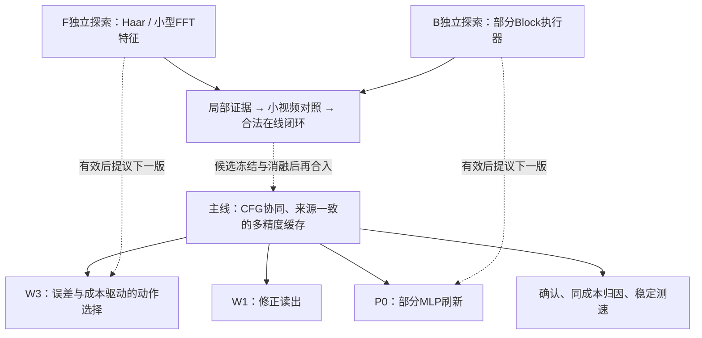

# WorldCache 当前主线与独立探索安排

2026-10-13。依据完整结果374/380/392/396/403/410/412、当前409/411 CPU验收与405执行状态，以及用户最新提供的频域与部分Block探索材料整理。**主线继续；F/B只进入独立探索设计，有真实收益后再考虑并入下一版。** 本文是当前导航，旧结果、判据、失败和已冻结实验原样保留。

[412当前结果和执行](412_WC_FB_COMPLETE_RESULTS_AND_INDEPENDENT_CONFIRMATION_LAUNCH_20261013.md)：F/B完整432接受、160曲线CPU接受；F特征当前没有决策增量，B有局部状态相关省时，仍独立。冻结405完整50确认正在运行，预计3–4小时，到21:02查收。当前实结72.013792437，CONF前余32.957570896GPUh；在途预留不是实耗。

[415独立B终点准备](415_WC_B_REAL_REFERENCE_AUDIT_AND_FULL312_PRODUCTION_PREPARATION_20261013.md)：原四点三臂（C_REPLAY／Dense速度／L2速度），4父＋12后缀／16视频，完整312pairs／624CFG；两flow数值CPU、四真实保存参考及730文件生产入口CPU已接受。预测2.236752758GPUh，尚未GPU；它只区分首次返回速度对终点的影响，首个真实缓存动作均为C，不验证B刷新来源或闭环加速。排在原CONF50和完整60曲线之后，F/B仍不并入主线。

[416 F决策边界分析](416_WC_F_DECISION_MARGIN_DECOMPOSITION_AND_NEXT_CPU_HYPOTHESIS_20261013.md)：旧16点RAW_SUB的标量误差下降中96.08%来自C/A共有误差，差值预测误差仅下降9.52%，三个原误选未跨过主档决策边界。登记直接预测传播加权动作收益差的CPU假设，尚未执行；旧五模型/三lambda/全部分母保持，主线不改。

## 1. 主线要解决什么

目标是 **CFG协同、来源一致的多精度缓存计算**：在质量与实际成本之间获得更好的选择，而不是要求每个配置同时比所有基线更快、更准。

|主线部分|现在实际做什么|还需回答的问题|
|---|---|---|
|W1 / A：怎样复用得更准|基于浅层信息修正读出；两CFG分支协调；D可信锚点与P工作来源分开，读出和误差标签对应同一来源|局部误差改善在哪些状态转化为视频收益？怎样保住已有A_NO_P/P_OFF正候选？|
|W3：怎样选择复用与刷新|当前H1按来源×阶段绝对guided MSE、传播gain²和实际动作费用选择C/A/P/D；支持域与保护规则独立记录|优于同成本简单规则吗？是输入自适应，还是一个更好的固定阶段策略？|
|P：重算能否更便宜|现P0只在四层对50% token做部分MLP，attention全算；近似来源有出生误差，不能冒充D|计算覆盖、缓存维护和后续重算是否抵消节省？|

主线建立在WorldCache和RA基础上；普通CFG联合风险、缓存或部分token计算本身不单独宣称原创。方法工作集中在**实际读出、来源质量、动作误差与真实费用之间的一致性及其收益**。

## 2. 已完成证据：哪些值得保留

|证据|发现与价值|适用边界|
|---|---|---|
|[374干净20次计时](374_WC_CLEAN_SPEED20_COMPLETE_RESULTS_20261012.md)|原两场景、五配置、正反两轮的测速已完成；A_NO_P出现相对Native/WC的速度与保真正信号；同A加入P更贵、质量进一步改善|原测速问题已回答，不能把新方法待测速说成原20次未完成；不跨批次混算速度|
|[380原N2](380_WC_MATH_N2_COMPLETE_SOURCE_GATE_POSITIVE_AND_ROUTER_A_UNUSED_RESULTS_20261012.md)|A_NO_P与P_OFF是不同成本的有效开发候选；来源门控有终点价值|旧H1/H2实际A=0、保护/支持回退问题保留为历史，不代表当前H1|
|[392同状态16点](392_WC_SOURCE_PHASE16_COMPLETE_POSITIVE_RESULTS_AND_CONSEQUENCE_NEXT_20261012.md)|来源一致A在16/16点优于C；P来源旧D参考仅2/8改善，一致读出8/8改善|局部监督不是终点；16点是自然父轨迹状态，其中14个原动作C、2个原动作P，不能统称16个自然C|
|[396单次A后果](396_WC_PI0_SUFFIX8_COMPLETE_RESULTS_LOCAL_TARGET_AND_FUTURE_COMPUTE_20261013.md)|AV28 LPIPS改善0.9812%，后续D+P由8到7；另外三点轻微退化，说明局部与终点需分别评价|取证计时、解码顺序效应保留，不据此宣称干净加速|
|[403完整新版H1](403_WC_ABSOLUTE_H1_COMPLETE_RESULTS_HIGH_FIDELITY_AND_NEXT_20261013.md)|36路径含12预热，24正式视频全93帧、全部控制完成；来源×阶段H1形成明显高保真工作点，A真实进入调度|四CAL、seed0、每格一次正式计时；不是独立确认或同成本优势|

403同批四场景等权结果：

|方法|平均主时间 / 秒|平均LPIPS ↓|目前用途|
|---|---:|---:|---|
|Native|283.2453|0|匹配原生参考|
|RA|147.0678|0.418610|强基础对照|
|A_NO_P|150.1533|0.378145|低额外成本修正锚点|
|P_OFF|156.7080|0.357051|进一步改善保真的锚点|
|TABLE_PHASE_H1|223.6088|0.058593|高保真候选|
|TABLE_POOLED_H1|151.4122|0.402727|来源池化消融|

H1比Native快 **1.2667×**；相对P_OFF失真下降 **83.5898%**，平均多 **66.9008秒**。这是值得确认的质量—时间工作点。四场景H1却采用同一序列：1–24步D，25–29步A，30步C，31步D，32–35步C，36步D，即 **26D/0P/5C/5A**。因此最大的未解问题是**更好读出与刷新选择的独立价值、可泛化性和真实成本**；不能把它写成四动作都已发挥作用或内容自适应成立。

LPIPS表示接近匹配Native的程度；旧MUSIQ/VQA混合证据继续保留。帧覆盖不是跨场景样本量，保真不等于物理质量。

## 3. 主实验队列：不因新探索改动

|顺序|任务|当前状态与完整范围|主要回答什么|
|---|---|---|---|
|已完成目标对齐控制|[410 teacher完整结果](410_WC_TEACHER_FIRST_COMPLETE_RESULTS_AND_TARGET_ALIGNMENT_20261013.md)|原4父＋8后缀＋4离线teacher pairs、270pairs/540CFG、12视频全93已接受；独立重算2正/2负场景，teacher相对C平均失真降低0.2077%，比单次A在3/4更低|当前完整teacher速度并不保证终点改善；两首C缓存相同，P点的局部速度/完整刷新状态价值需要区分|
|F/B完整终态后，保护确认|[405冻结H1独立确认](405_WC_FROZEN_H1_INDEPENDENT_CONFIRMATION_FULL50_FINAL_PRODUCTION_PREREG_20261013.md)|四新提示词×seed17/43×Native/RA/A_NO_P/P_OFF/H1，40正式＋10预热。最终生产CPU通过，冻结e48ba58/684；16:51:26唯一启动，预计6.56135GPUh，21:01:59到时查收；全40正式评分待|新输入/seed上的保真与成本；不会把探索特征或P-v2加入这50路径|
|必要归因|H1同mask/读出消融与匹配真实成本曲线|[411十方法完整60规划与160路径CPU](411_WC_H1_FULL60_COST_CURVE_AND_STATIC_CONTROL_CPU_PREPARATION_20261013.md)两flow完整160 CPU与[413实际完整60生产CPU](413_WC_H1_COST_CURVE_FULL60_PRODUCTION_AND_POST_PREREG_20261013.md)已接受（361ea5c/711/R2），未GPU；三个λ沿原登记值，确认集不调参|[409独立80路径CPU准备](409_WC_H1_FIXED_MASK_ATTRIBUTION_CPU_PREPARATION_20261013.md)完整两flow80路径CPU已通过；固定mask＋同读出复现作为等价控制；同mask＋plain C隔离A；匹配D次数仅是机制对照，仍需匹配实际时间。静态策略若已足够，也作为有价值结果保留|
|速度确认|新版候选的驻留模型平衡重复计时|待卡；原两场景五方法30正式＋10预热方案保留，最终方法名单先冻结|每场景逐轮秒数、波动、基线÷候选倍数与LPIPS；包含真实缓存/修正费用，加载与保存另列|
|P成本开发|P0实际profile与单一覆盖轴|待；先核算完整双CFG深层与维护费用|为何单次节省小、扩大MLP覆盖是否有意义；B探索可复用这份证据，不能双重报成果/费用|
|可选低成本研究|来源/噪声时钟、H2短时域|已有设计，未获新的终点证明|按具体信号推进，不作为确认现有强候选的额外门槛|

昂贵GPU和原CPU post严格串行；原teacher已结束。用户要求的F/B408已完整查收并接受GPU/post结算与锁释放；405确认随后单次准入，按21:02查收，不持续监听。409只在独立目录作CPU准备，不改预算或原任务。当前不改变主线source、γ、λ、输入、读出、动作、费用、支持域、保护规则或评分协议。

## 4. 新探索放在哪里

[F/B独立探索设计](../plans/WORLD_CACHE_SPECTRAL_BLOCK_ISOLATED_EXPLORATION_20261013.md)规定数据、完整对照、费用与合入依据。**当前主方法不启用F/B；独立首批完整432及GPU/post已接受。** [412完整结果](412_WC_FB_COMPLETE_RESULTS_AND_INDEPENDENT_CONFIRMATION_LAUNCH_20261013.md)记录F当前配置没有动作增量、B四状态局部成本—误差取舍和后续终点要求。[414三臂后缀探索](414_WC_B_LOCAL_CONDITIONS_AND_SAVED_VELOCITY_ENDPOINT_CPU_DESIGN_20261013.md)新增只改首速度的四点终点对照，32父/64后缀CPU已接受；实际B视频/刷新来源闭环未运行，继续独立。原登记范围见[408](408_WC_FB_FULL432_PREREG_AND_DELAYED_CHECK_20261013.md)，旧材料与E0证据见[407](407_WC_SPECTRAL_BLOCK_INTAKE_MATH_AND_E0_20261013.md)。

F回答“已有raw/RA＋来源＋阶段信息之外，多尺度特征是否改善动作判断”；B回答“保留当前上下文，只少算部分增量能否降低实际刷新费用”。二者允许分别有效，也允许组合产生价值；不强求全部模块同时成功。

## 5. 预算与判断方式

新增48GPUh窗口起点仍为56.971363333，累计cap104.971363333；完整F/B实结2.664073208后，累计 **72.013792437GPUh**、余 **32.957570896GPUh**，这是新CONF准入前的实际结算。F/B前69.349719229、teacher前68.668097882快照保留。当前CONF预留used=cap只是保守预留，不是已耗尽；其完整费用在GPU/post结束后再接受。

确认/稳定测速与关键归因优先保护约14GPUh的规划空间（其中包含6.56135确认卡，非额外再加一次）。F/B先规划 **至多约6GPUh**，属于现有窗口的待估投入，不新增48、不锁定必须花完、不承诺6小时完成全部阶段。新卡以实测全范围费用另行登记，≤8按既有授权、严格>8询问；不得拆缩已冻结卡规避阈值。原E2完整76自身权限、用户暂缓的P-reference13小时卡保持。

每一轮按“有效条件 / 当前配置失败 / 证据不足 / 技术缺口”报告。负结果先核对实现、标签和目标是否对齐；有可区分的线索就做小成本后续。探索只出现局部相关性或单算子优势时继续作为开发证据；取得含所有费用的可复验视频质量—时间收益后，形成具体下一版合入建议，保留原主线对照与消融，不回写旧结论。
