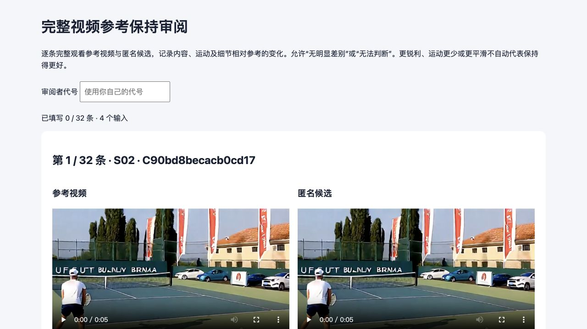

# B36 原视频审阅承接与 F18 静态 CPU

2026-10-30。B36 的原 GPU、评分与正式图表已经完整接受，本轮完成 32 条原视频匿名审阅页面及浏览器核验，同时补齐 F18 静态可辨识性。新增 GPU、预约、指标计算和人类审阅均为 0；原 A32 冻结及 B36 完整结果保持。

## 原连接与账本

用户修复 Windows Clash 后，原办公机 Tailscale 入口重新在线；原两卡与四卡 SSH 分别登录到 `minchen-X11DAi-N` 和 `user-Super-Server`。中继曾中断，下载保留原断点后完成。任务私有跳板连接等待由 10 秒改为 30 秒；全局 SSH、Mac Clash、Tailscale 登录和密钥均未修改。未检查具体 Windows Clash 规则，不能据此确定某条规则为根因，也不把一次恢复视为连接长期稳定。

[中央账本只读复核](../reports/cara_fast_mainline_budget_readonly_r1_20261030.json)确认原 B36 仍为 SETTLED，实际 2.384553982338661 GPUh；cap 226、used 180.44611925467495、reserved 16.5、available 29.053880745325046 GPUh。本轮没有写账本或再次结算。该时点余额不替代未来派发的资源、责任与预算准入。详见[连接记录](../reports/cara_fast_mainline_Tailscale_recovery_r1_20261030.json)；原完整接受见 [756](756_CARA_B36_COMPLETE_ACCEPTANCE_RESULTS_AND_FIGURES_20261029.md)。

## 32 条原视频审阅包

从原评分 manifest 的 32 份视频只读核验并复制，共 28,447,191 字节。传输归档为 28,453,997 字节，SHA-256 为 `2cbaa0ded3fe3a245601cb61730a62855c8a7a1dcdbb5b2b28837cea488622ce`。中断仅续传原归档，未生成或重编码视频。源端复制、完整传输和页面装配分别见[复制回执](../reports/cara_fast_B36_review_video_copy_r1_20261030.json)、[传输接受](../reports/cara_fast_B36_review_video_transfer_r1_20261030.json)和[装配回执](../reports/cara_fast_B36_review_materialized_r1_20261030.json)。

公开包包括四个旧 CAL 输入、每输入八个原角色，共 32 条比较，包含四条 Native 自比较。四份参考复用，目录内共 36 份媒体文件。每个输入使用同一个原 Native 参考；顺序与案例编号由私有随机键生成。公开页面没有方法名、分数、时钟、服务器路径或解盲映射；协调文件以 0600 权限留在忽略目录，视频也不入 Git。

审阅维度为内容与动作、运动、可见细节，均允许“无明显差别”及“无法判断”。页面保存填写进度，导出完整观看声明、播放范围和备注。所有原视频保持 93 帧、16 fps；未缩放、剪裁、重采或重算科学指标。作者诊断与独立人类证据分别接受，不因 JSON 填满就断言独立审阅成立。操作与恢复方法见[承接说明](../plans/cara_next_stage_20261028/mainline/r2/B36_ANONYMOUS_REVIEW_R1.md)。

[本地组件 CPU 接受](../reports/cara_fast_B36_review_component_CPU_acceptance_r1_20261030.json)通过八项控制，覆盖完整范围、匿名性、错误原件拒绝、原字节复制、映射恢复、公开目录边界及结构完整性；页面脚本通过 Node 语法检查。生产 CLI 在装配前重建五份原接受回执并核验全部原件。

[浏览器接受](../reports/cara_fast_B36_review_browser_QA_r1_20261030.json)逐条验证 32/32 比较的两段视频均可加载，尺寸 768×432、时长 5.8125 秒，无媒体错误；同步播放到末尾、前后导航、填写保存及 JSON 下载均通过。测试导出明确标记 `CPU_TEST_NOT_A_HUMAN`、INCOMPLETE、32 行、0 个完整观看声明，另存忽略目录。交接使用新本地端口，表单与审阅者为空，进度 0/32，不带测试填写。

## 完整结果的描述性诊断

仅读取已接受的完整 B36 分数，不运行指标网络。A1 相对 C 的 Alex 改善分布如下：

| 旧 CAL 输入 | 原分区 | Alex 相对降低 | 93 帧中 A1 较低 / 较高 |
|---|---|---:|---:|
| AV28 | FIT | 13.7184% | 93 / 0 |
| Human199 | FIT | 0.7394% | 53 / 40 |
| misc133 | CHECK | 10.5053% | 93 / 0 |
| AV51 | CHECK | 1.6452% | 60 / 33 |

AV28 与 misc133 占总绝对 Alex 改善的 93.0564%。这是四个旧 CAL 输入上的描述性分布；帧不是独立样本，视频帧号也不是扩散刷新步。它不新增筛选或否决规则，也不代替独立输入或人类观察。F19_C 的 T_DD 与 Uniform19_C 几乎相同且略慢，不能称为严格时间支配。原 T_DD 与完整请求速度仍分列。见[诊断回执](../reports/cara_fast_B36_post_result_diagnostics_r1_20261030.json)。

## F18 静态可辨识性与下一步

[静态 CPU 回执](../reports/cara_fast_F18_identifiability_CPU_r1_20261030.json)通过八项结构控制。F18 的 D 为 `1..7,10,12,14,16,18,20,21,24,27,30,36`；A1 仅在 `8,11,13,15,17,19` 使用六次 age1 A。step 9 保持 C，来源为 D7、age2，不扩张 A 窗口。Uniform18 在实际 sigma 网格上确定生成，保护首七步与末步。

F18-C、F18-A1、Uniform18-C 三种完整执行身份各不相同，因此两个原 CHECK 输入共有六个不同逻辑位置，没有等价别名可扣减。六位置不是整卡物理条数；预热、重复、等价控制、双端受影响路径生产 CPU 和整卡报价均未冻结，GPU 不就绪。

F19_C 已达到约 1.5 倍 T_DD 的开发速度目标，Alex 约 0.249 仍高于约 0.10 的开发目标。后续保持 S 优先，先补原视频观察及冻结方法，再按原总计划决定唯一相邻预算/新网格。S/Q 执行仍由原对话负责，本轮未修改其文件、恢复其资源轮询或派发 GPU。原最终输入与额外 seed 未曝光。

原 52 份执行、4 份汇总、6 份绘图源码及 A32 冻结 SHA 均重新核对保持；原 26 新评分加六份 A 指标未重算，WC/RA 仍为 FIT UNMATCHED。这里只完成 CPU 与审阅承接，不形成新科学接受。
